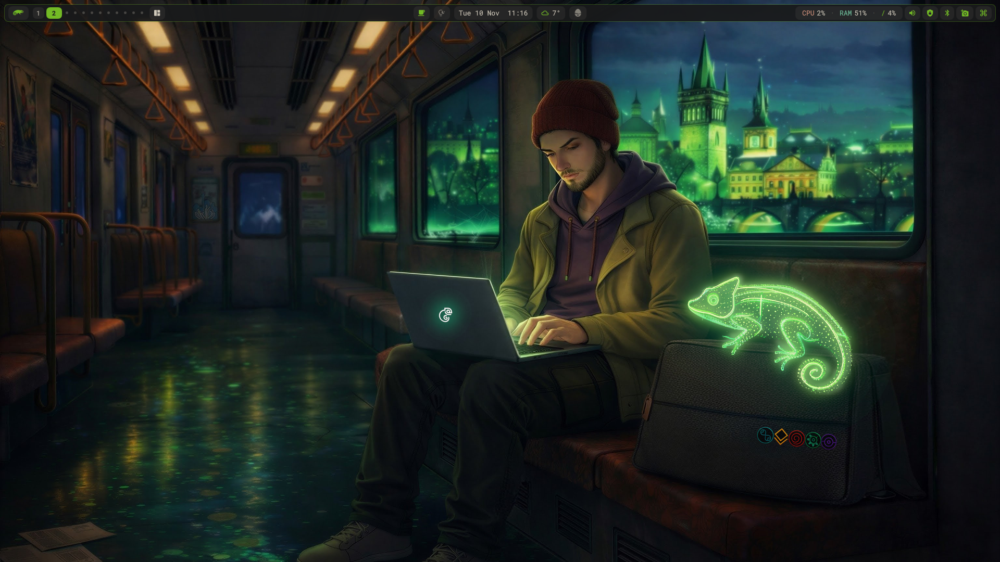

# mangobutter

mangobutter: butterdwm's Wayland cousin. Same butter, more mango.


[MangoWM](https://github.com/mangowm/mango) at the core, a quickshell bar on top, for Debian 13 (trixie).
dwm's brain with Hyprland's face, on plain Debian stable.



> 📚 **The documentation is the [wiki](https://justaguy.dev/drew/mangobutter/wiki).** This README gets you installed and tells you the three things to know. Everything else, keybinds, the settings panel, scratchpads, theming, multi-monitor, the 0.14.4 pin, upgrading, troubleshooting, lives there.

Starting from a bare machine? [butterknife](https://justaguy.dev/drew/butterknife) installs Debian 13 with this setup picked from a menu. Part of the [JustAGuy Linux](https://justaguy.dev/drew) window manager collection and the [Butterbian](https://butterbian.org) family. Formerly mangowc-setup; the old URL redirects.

---

## INSTALL

```bash
sudo apt install git      # a minimal Debian doesn't have it
git clone https://justaguy.dev/drew/mangobutter.git
cd mangobutter
./install.sh
```

```
./install.sh [OPTIONS]

  --only-config      Only copy config files (skip packages)
  --help             Show usage
```

Then reboot and pick **Mango** at the login screen. The installer refreshes and upgrades the system (`apt-get upgrade`), adds [butterrepo](https://justaguy.dev/drew/butterrepo) and takes the compositor stack and themes from it (`mangowc` 0.14.4, `libwlroots-0.19`, `libscenefx-0.4`, `quickshell`, `rofi`, `awww`, Orchis and Colloid), installs the rest from Debian (see the wiki's [Packages](https://justaguy.dev/drew/mangobutter/wiki/Packages) page), pulls kitty, Nerd Fonts and LightDM through [butterscripts](https://justaguy.dev/drew/butterscripts), installs the `mango-session` login wrapper, and ends with an optional tools prompt.

Debian 13 is the only base. Anything else, forky, sid, Ubuntu, the installer refuses on purpose: the reason is the wlroots pin, explained on the wiki's [Why 0.14.4](https://justaguy.dev/drew/mangobutter/wiki/Why-0.14.4) page.

> ⚠️ **NVIDIA: untested.** Only run on AMD so far. The installer runs `nvidia-setup.sh` when it sees the proprietary driver; nobody has verified blur, shadows and rounded corners on it. Reports welcome either way.

> 🪵 **Branches:** `main` is the release, `dev` is where work lands.

---

## THREE THINGS TO KNOW

1. **`Super + /` opens the settings panel.** Keybinds, window rules and scratchpads, layouts, gaps and effects, displays and wallpapers, one place with vertical tabs. Most things you would edit a file for are a click here.

2. **Your config is six files in `~/.config/mango/`.** `keybinds.conf` is every binding, `rules.conf` every window rule and scratchpad, `local.conf` your overrides (read last, so they win), plus `autostart.conf`, `env` and the `config.conf` that sources them. The setup's own files live in `~/.local/share/mango` and are replaced on update; yours are treated like `dpkg` treats a conffile.

3. **`Super + Shift + R` reloads.** No restart, no logout. `mango -p` checks a config for mistakes and names the file and line.

Everything else is on the wiki: [Keybinds](https://justaguy.dev/drew/mangobutter/wiki/Keybinds) · [Settings Panel](https://justaguy.dev/drew/mangobutter/wiki/Settings-Panel) · [Scratchpads](https://justaguy.dev/drew/mangobutter/wiki/Scratchpads) · [Customization](https://justaguy.dev/drew/mangobutter/wiki/Customization) · [Themes](https://justaguy.dev/drew/mangobutter/wiki/Themes) · [Multi-Monitor](https://justaguy.dev/drew/mangobutter/wiki/Multi-Monitor) · [Why 0.14.4](https://justaguy.dev/drew/mangobutter/wiki/Why-0.14.4) · [Upgrading](https://justaguy.dev/drew/mangobutter/wiki/Upgrading) · [Troubleshooting](https://justaguy.dev/drew/mangobutter/wiki/Troubleshooting)

---

## WHY MANGO

Mango is dwm's model, tags and a master stack, as a wlroots compositor with scenefx underneath: blur, shadows, rounded corners and animations without a plugin in sight. It reads one text config, reloads it in place, and has an IPC the bar can talk to. On top of it sits the same [quickshell](https://quickshell.org/) bar as [butterdwm](https://justaguy.dev/drew/butterdwm): tag pills with live occupancy, a launcher, layout picker, tray, media, weather, network, the settings panel, and wallpaper-driven theming that recolors the whole desktop. On Wayland it is a layer-shell surface, so there is nothing to patch and nothing to hand-merge on the next release. The full reasoning is on the wiki's [Architecture](https://justaguy.dev/drew/mangobutter/wiki/Architecture) page.

---

## WHAT'S IN THE BOX

| Component | Job |
|---|---|
| **mangowc** | Tiling Wayland compositor, 0.14.4, built with 12 tags |
| **quickshell bar** | Tags, launcher, layout picker, tray, media, network, weather, power, settings panel |
| **Wallpaper theming** | Pick a wallpaper and the desktop, terminal and GTK re-theme from it |
| **kitty** | Terminal, with a session-local config |
| **awww** | Wallpaper daemon; wallpapers wipe in |
| **dunst** | Notifications |
| **grim + slurp + swappy** | Screenshots and annotation |

---

## CREDITS

This project is a config on top of other people's software. Mango is by [DreamMaoMao](https://github.com/DreamMaoMao) and [contributors](https://github.com/mangowm/mango), on [wlroots](https://gitlab.freedesktop.org/wlroots/wlroots) and [scenefx](https://github.com/wlrfx/scenefx). Quickshell by [outfoxxed](https://git.outfoxxed.me/quickshell/quickshell). awww by [LGFae](https://codeberg.org/LGFae/awww). rofi-wayland by [lbonn](https://github.com/lbonn/rofi). dunst by the [dunst project](https://dunst-project.org). kitty by [Kovid Goyal](https://sw.kovidgoyal.net/kitty/). GTK and icon themes by [vinceliuice](https://github.com/vinceliuice): [Orchis](https://github.com/vinceliuice/Orchis-theme) and [Colloid](https://github.com/vinceliuice/Colloid-icon-theme).

## LICENSE

GPL-2.0. See [LICENSE](LICENSE).

## SUPPORT

<a href="https://www.buymeacoffee.com/justaguylinux" target="_blank"></a>

## CONNECT

- [YouTube](https://youtube.com/@justaguylinux) — tutorials and guides
- [Butterforge](https://justaguy.dev/drew) — source code and projects
- [The Butter Lab](https://lab.justaguylinux.com) — Discourse forum
- [The Churn](https://justaguylinux.chat) — community chat (Fluxer)
- [Wiki](https://justaguy.wiki) — documentation and guides
- [Mastodon](https://fosstodon.org/@justaguylinux) — @justaguylinux@fosstodon.org
- [Butterbian](https://butterbian.org) — a Debian-based distro

---

Made with butter by JustAGuyLinux
