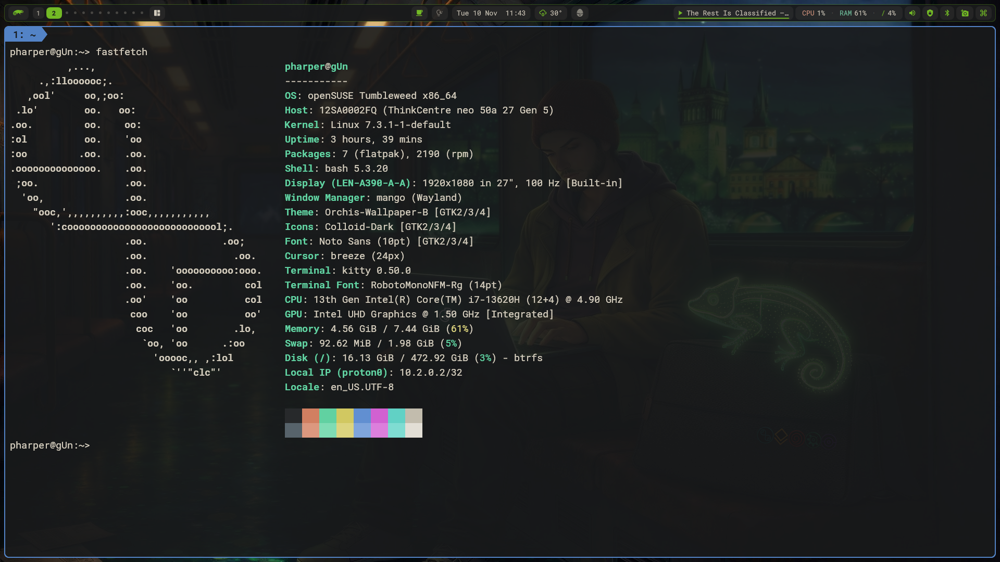

# 🥭 mango_opensuse

**A MangoWM desktop for openSUSE Tumbleweed.** Tags and a master stack, blur and rounded corners, a quickshell bar on top, and wallpaper-driven theming, installed in one go with `zypper`.




> 🧈 **All credit to Drew of [JustAGuyLinux](https://justaguy.dev/drew).** This is an openSUSE Tumbleweed port of his [mango setup](https://justaguy.dev/butter/mango) (mangobutter), the Wayland cousin of his [butterdwm](https://justaguy.dev/butter/dwm). The bar, the settings panel, the wallpaper theming, the scripts, the config layout and the design are all his work. This fork only changes how it gets onto Tumbleweed and adds a few extras on top. If you like it, [support Drew](#support-drew) and follow his work.

---

## INSTALL

```bash
sudo zypper in git
git clone https://github.com/pauljamesharper/opensuse_mango.git
cd opensuse_mango
./install-opensuse.sh
```

```
./install-opensuse.sh [OPTIONS]

  --only-config   Config files, plus packages added to the list since (never removes any)
  --rebuild       Rebuild mangowc, scenefx, quickshell, butterpal, butterview and themes
  --help          Show usage
```

Then reboot and pick **Mango** at the SDDM login screen.

The installer:

- takes everything it can from the official Tumbleweed repos with `zypper` (no third-party desktop repo)
- builds `mangowc` 0.14.4 (with the patches Drew's packages carry), scenefx 0.4.1, quickshell, butterpal and butterview from source into `/usr/local`, and rebuilds them only when they are out of date or Tumbleweed moves Qt or wlroots underneath them
- builds the Orchis and Colloid themes from vinceliuice's tagged releases
- installs the `mango-session` login entry and keeps SDDM
- installs the Nerd Fonts through Drew's [butterscripts](https://justaguy.dev/drew/butterscripts)
- rewrites the bar's package commands (update counter, "Check for updates", install hints) to `zypper`

openSUSE Tumbleweed is the only base. Slowroll should behave the same but is untested. Leap is refused because its wlroots and Qt are too old.

After a big Tumbleweed snapshot (new Qt or wlroots), if the bar or mango won't start, run `./install-opensuse.sh --rebuild`.

> ⚠️ **NVIDIA: untested.** The installer runs `nvidia-setup.sh` when it sees the proprietary driver; nobody has verified blur, shadows and rounded corners on it.

---

## EXTRAS IN THIS FORK

**Flatpaks.** Flathub is added system-wide and these apps are installed from it:

| App | Why |
|---|---|
| [Focus Timer](https://flathub.org/apps/io.github.focustimerhq.FocusTimer) | Pomodoro timer |
| [Telegram](https://flathub.org/apps/org.telegram.desktop) | Chat |

Add your own to the `FLATPAKS` list in `install-opensuse.sh`; `--only-config` installs anything new.

**mise and Claude Code.** [mise](https://mise.jdx.dev) comes from its own zypper repo, gets activated in `~/.bashrc`, and installs [Claude Code](https://claude.com/claude-code) with `mise use -g claude@latest`. Upgrade it later with `mise upgrade claude`.

**Packages.** git, stow, vim, emacs, alacritty and blueman; tesseract OCR and wtype; Noto fonts for CJK, Thai, Arabic and Khmer. IceWM is removed and locked.

**First-run setup.** `first-run/` is an Omarchy-style one-time setup that opens in a terminal at the first login. It sets the hostname and git identity, starts an ssh-agent user service, creates an Ed25519 key and walks you through adding it to Codeberg, GitHub and GitLab, then runs `zypper dup`. Run it again any time with `mango-first-run --force`.

**openSUSE look.** The launcher on the bar is the openSUSE chameleon.

---

## FOUR THINGS TO KNOW

1. **`Super + /` opens the settings panel.** Keybinds, window rules and scratchpads, layouts, gaps and effects, displays and wallpapers, one place with vertical tabs. Most things you would edit a file for are a click here.

2. **Your config is six files in `~/.config/mango/`.** `keybinds.conf` is every binding, `rules.conf` every window rule and scratchpad, `local.conf` your overrides (read last, so they win), plus `autostart.conf`, `env` and the `config.conf` that sources them. The setup's own files live in `~/.local/share/mango` and are replaced on update; yours are kept like a package manager keeps an edited config file.

3. **`Super + Shift + R` reloads.** No restart, no logout. `mango -p` checks a config for mistakes and names the file and line.

4. **Updating is a menu entry.** `Super + Shift + m`, then **Update setup**: it pulls the clone you installed from and runs `install-opensuse.sh --only-config` in place. A file you edited stays as it is; if the shipped version changed too, the new one lands beside yours as `.new` and the installer says so, once. The setup's own files are replaced, your settings and colors are left alone. Nothing checks on its own. [Upgrading](https://justaguy.dev/butter/mango/wiki/Upgrading) has the rule.

Everything else is on Drew's wiki (written for his original; the desktop works the same here, only the install and package steps differ): [Keybinds](https://justaguy.dev/butter/mango/wiki/Keybinds) · [Settings Panel](https://justaguy.dev/butter/mango/wiki/Settings-Panel) · [Scratchpads](https://justaguy.dev/butter/mango/wiki/Scratchpads) · [Customization](https://justaguy.dev/butter/mango/wiki/Customization) · [Themes](https://justaguy.dev/butter/mango/wiki/Themes) · [Multi-Monitor](https://justaguy.dev/butter/mango/wiki/Multi-Monitor) · [Why 0.14.4](https://justaguy.dev/butter/mango/wiki/Why-0.14.4) · [Upgrading](https://justaguy.dev/butter/mango/wiki/Upgrading) · [Troubleshooting](https://justaguy.dev/butter/mango/wiki/Troubleshooting)

---

## WHY MANGO

Mango is dwm's model, tags and a master stack, as a wlroots compositor with scenefx underneath: blur, shadows, rounded corners and animations without a plugin in sight. It reads one text config, reloads it in place, and has an IPC the bar can talk to. On top of it sits the same [quickshell](https://quickshell.org/) bar as [butterdwm](https://justaguy.dev/butter/dwm): tag pills with live occupancy, a launcher, layout picker, tray, media, weather, network, the settings panel, and wallpaper-driven theming that recolors the whole desktop. On Wayland it is a layer-shell surface, so there is nothing to patch and nothing to hand-merge on the next release. The full reasoning is on the wiki's [Architecture](https://justaguy.dev/butter/mango/wiki/Architecture) page.

---

## WHAT'S IN THE BOX

| Component | Job |
|---|---|
| **mangowc** | Tiling Wayland compositor, 0.14.4, built with 12 tags |
| **quickshell bar** | Tags, launcher, layout picker, tray, media, network, weather, power, settings panel |
| **Wallpaper theming** | Pick a wallpaper and the desktop, terminal and GTK re-theme from it |
| **kitty** | Terminal, with a session-local config |
| **awww** | Wallpaper daemon; wallpapers wipe in |
| **dunst** | Notifications |
| **grim + slurp + swappy** | Screenshots and annotation |
| **butterview** | Image viewer |

---

## CREDITS

**Drew ([JustAGuyLinux](https://justaguy.dev/drew))** made this setup: the mango config, the quickshell bar and its settings panel, the wallpaper theming, the scripts, butterpal and butterview. The original lives at [justaguy.dev/butter/mango](https://justaguy.dev/butter/mango), with its [wiki](https://justaguy.dev/butter/mango/wiki). This repo is only the openSUSE Tumbleweed port.

Drew's setup is itself built on other people's software. Mango is by [DreamMaoMao](https://github.com/DreamMaoMao) and [contributors](https://github.com/mangowm/mango), on [wlroots](https://gitlab.freedesktop.org/wlroots/wlroots) and [scenefx](https://github.com/wlrfx/scenefx). Quickshell by [outfoxxed](https://git.outfoxxed.me/quickshell/quickshell). awww by [LGFae](https://codeberg.org/LGFae/awww). rofi-wayland by [lbonn](https://github.com/lbonn/rofi). dunst by the [dunst project](https://dunst-project.org). kitty by [Kovid Goyal](https://sw.kovidgoyal.net/kitty/). GTK and icon themes by [vinceliuice](https://github.com/vinceliuice): [Orchis](https://github.com/vinceliuice/Orchis-theme) and [Colloid](https://github.com/vinceliuice/Colloid-icon-theme).

---

## Support Drew

<a href="https://www.buymeacoffee.com/justaguylinux" target="_blank"></a>

## Drew's work

- [YouTube](https://youtube.com/@justaguylinux) — tutorials and guides
- [Butterforge](https://justaguy.dev/drew) — source code and projects
- [Butter desktops](https://justaguy.dev/butter) — more of Drew's ready-to-use window manager desktops
- [The Butter Lab](https://lab.justaguylinux.com) — Discourse forum
- [The Churn](https://justaguylinux.chat) — community chat (Fluxer)
- [Wiki](https://justaguy.wiki) — documentation and guides
- [Mastodon](https://fosstodon.org/@justaguylinux) — @justaguylinux@fosstodon.org
- [Butterbian](https://butterbian.org) — Drew's own distribution

## License

GPL-2.0, as upstream. See [LICENSE](LICENSE).

---

Made with 🧈 by [JustAGuyLinux](https://justaguy.dev/drew) · ported to openSUSE Tumbleweed by [pauljamesharper](https://github.com/pauljamesharper)
